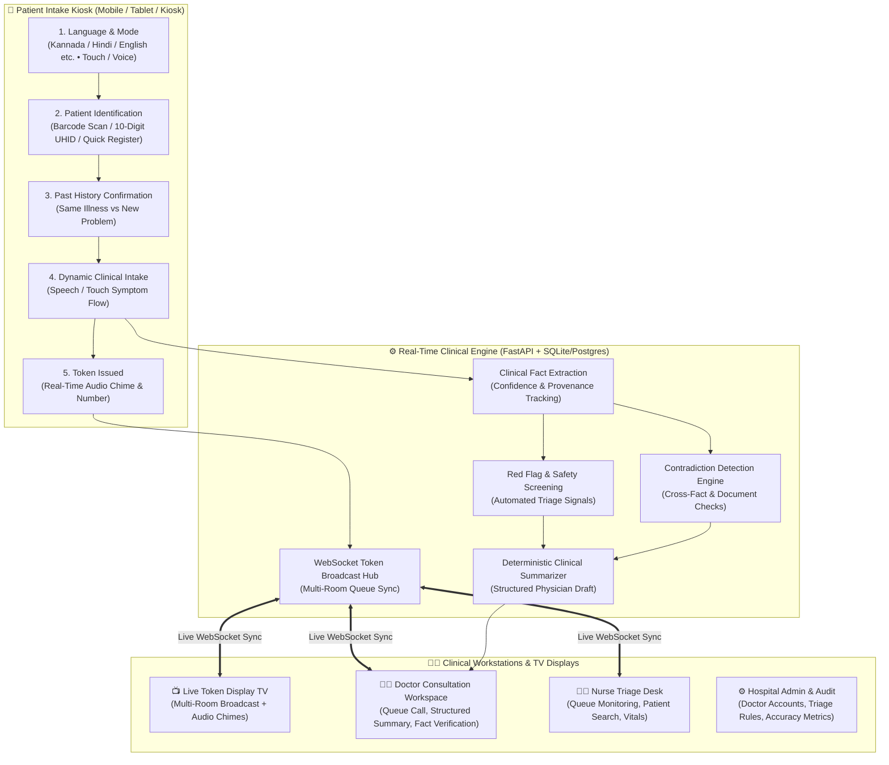
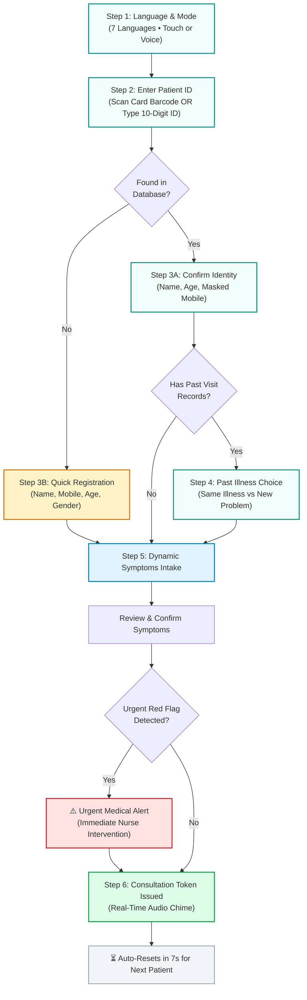

# 🏥 MediKiosk — Smart Multilingual Hospital Intake & Physician Workflow Platform

> Supports **7 Regional Languages** (Kannada, Hindi, Marathi, Tamil, Odia, Nepali, English) with large touch controls, voice guidance, live barcode scanning, and multi-room TV token broadcast.

> 🏆 **Smart India Hackathon (SIH) Evaluation Dossier:**  
> Detailed SIH submission documentation covering **Technical Approach**, **Feasibility & Viability**, **Impact & Benefits**, and **System Architecture** is available in [**`SIH_DOCS/`**](SIH_DOCS/README.md).

> 📖 **Comprehensive Folder-by-Folder Documentation:**  
> Detailed architecture, file-by-file breakdowns, and data flow guides for every module are located in the [**`MASTER README/`**](MASTER%20README/README.md) directory.

---

## 🌟 System Architecture & Workflow



---

## 🚀 How to Start the App (1-Command Unified Launcher)

### Option 1: Double-Click Launcher (Windows)
Double-click:
```cmd
start_medikiosk.bat
```
*Automatically starts the Backend, Frontend, and Mobile HTTPS Tunnel with keep-alive, opening `http://localhost:3000` in your browser.*

### Option 2: Command Line (Any OS)
```bash
# 1. Install dependencies
npm install

# 2. Start Full Suite (Laptop + Mobile Tunnel)
npm run dev:all
```

*Or start local-only:*
```bash
npm run dev
```

---

## 🌐 Quick Access Portals

| Portal | URL | Description |
| :--- | :--- | :--- |
| **🏠 Portal Launchpad** | [http://localhost:3000](http://localhost:3000) | Hub to launch all patient, doctor, display, nurse, and admin portals |
| **🏥 Patient Kiosk** | [http://localhost:3000/patient](http://localhost:3000/patient) | Touch & voice self check-in station with 7 regional languages |
| **👨‍⚕️ Doctor Station** | [http://localhost:3000/doctor](http://localhost:3000/doctor) | Doctor consultation queue, structured AI summary & prescription builder |
| **👩‍⚕️ Nurse Station** | [http://localhost:3000/nurse](http://localhost:3000/nurse) | Nurse triage queue monitoring, patient history lookup & vitals |
| **📺 Token Display** | [http://localhost:3000/tokens](http://localhost:3000/tokens) | Multi-room live waiting-room TV display with simultaneous calling & audio chime |
| **⚙️ Admin Station** | [http://localhost:3000/admin](http://localhost:3000/admin) | Physician accounts, triage safety rules & AI accuracy benchmarks |
| **📖 API Documentation** | [http://localhost:8000/docs](http://localhost:8000/docs) | Interactive FastAPI Swagger documentation & test sandbox |
| **🗄️ Database Schema** | [docs/DATABASE_SCHEMA.md](docs/DATABASE_SCHEMA.md) | Complete reference for all 20 active database tables & relationships |

---

## 📱 Running on Mobile Phones & Tablets

MediKiosk features a **Single Universal QR Code** that works seamlessly across all devices:

- When you run `npm run dev:all`, a **single scannable QR code** is printed right in your terminal.
- **Universal Accessibility:** Works whether your phone is on the **same Wi-Fi** or using **4G/5G mobile data**.
- **Auto-Reconnect Keep-Alive:** The tunnel daemon runs in the background with 10-second heartbeats and automatic reconnection so the link never drops or times out.
- Enables camera barcode scanning and microphone voice guidance with HTTPS permissions out of the box.

---

## 🗺️ Step-by-Step Patient Check-In Journey



---

## 👨‍⚕️ Doctor Consultation Workspace (4-Tab Interface)

The attending physician consultation workstation (`/doctor`) provides a streamlined 4-tab workflow:

1. **📋 Summary:** Structured view of patient-reported chief complaints, symptom duration, associated symptoms, step details, current daily medications, and known drug allergies.
2. **📜 Past Medical History:** Longitudinal history of previous hospital OPD visits, past diagnoses, and previous treatments.
3. **📄 Documents:** Encounter documents (prescriptions, lab reports, discharge summaries) with extracted OCR text.
4. **💊 Prescription & Medicines:** Interactive prescription builder with instant quick-fill chips for common medications (Dolo 650, Augmentin, Pan 40, Cetirizine, etc.), custom dosage/schedule builder, doctor notes, diagnosis input, and one-click saving to the patient record.

---

## 🧪 Testing & Quality Assurance

The codebase includes an automated test suite verifying AI fallback resilience, contradiction detection, red flag safety rules, FHIR exports, and token queues.

```bash
# Run all backend unit & integration tests
pytest

# Run frontend TypeScript typecheck
npm run typecheck
```

---

## 🔒 Safety & Medical Disclaimer

> [!IMPORTANT]
> **Safety Principle:** MediKiosk is designed to assist hospital intake workflows by collecting structured symptoms and history in advance. It **never** prescribes medications, issues autonomous medical diagnoses, or bypasses clinical oversight. All AI extractions require explicit human verification by a licensed healthcare professional.
