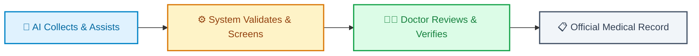
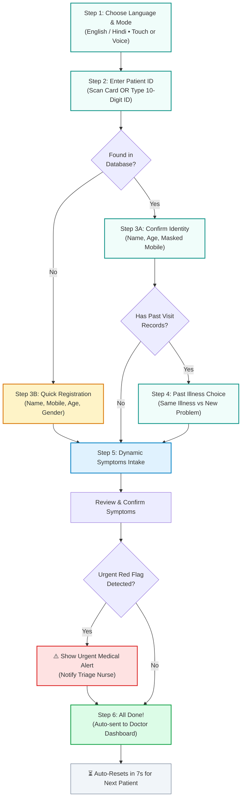
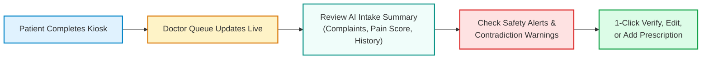

# 🏥 MediKiosk — Smart Multilingual Hospital Intake Platform

> **Simple, fast, and accessible digital patient check-in for busy outpatient hospital clinics.**  
> Supports **English** and **हिंदी (Hindi)** with large touch controls, voice guidance, and smart symptom collection.

---

## 🌟 The Core Principle



> [!IMPORTANT]
> **Safety First:** MediKiosk assists patients and doctors by collecting information in advance. It **never** prescribes medicines or replaces the doctor. Every summary and extraction must be confirmed by a licensed physician.

---

## 🚀 How to Start the App (1-Click Setup)

### Option 1: Double-Click the Launcher (Windows)
Simply double-click:
```cmd
start_medikiosk.bat
```
*This opens your browser and starts everything with live auto-refresh enabled.*

### Option 2: Run in Terminal (Mac / Linux / Windows)
```bash
npm install
npm run dev
```

---

## 🌐 Quick Access Links

| Portal | URL | Description |
| :--- | :--- | :--- |
| **🏠 Portal Launchpad** | [http://localhost:3000](http://localhost:3000) | Choose between Patient, Doctor, and Admin views |
| **🏥 Patient Kiosk** | [http://localhost:3000/patient](http://localhost:3000/patient) | Touch & voice self check-in station for patients |
| **👨‍⚕️ Doctor Station** | [http://localhost:3000/doctor](http://localhost:3000/doctor) | Doctor consultation queue, AI summary & verification |
| **⚙️ Admin Station** | [http://localhost:3000/admin](http://localhost:3000/admin) | Hospital triage rules & accuracy benchmarks |
| **📖 API Documentation** | [http://localhost:8000/docs](http://localhost:8000/docs) | Interactive backend API testing interface |

---

## 🗺️ Step-by-Step Patient Check-In Journey



---

## 🎯 Key Features Explained Simply

### 1. 🗣️ Continuous Spoken Voice Guidance
- When the patient chooses **VOICE**, the kiosk gently speaks instructions in their language (English or Hindi) at **every step**.
- If voice recognition is noisy, the patient can simply tap the screen at any time.

### 2. ⚡ Adaptive Symptom Collection (No Long Forms)
- Instead of showing a giant medical form, the kiosk asks:  
  **"Select the problem that best describes why you are visiting today."**
- The system automatically asks follow-up questions based on the complaint:
  - **Fever:** How many days? Any chills, body pain, or cough?
  - **Pain:** Interactive body area picker (Head, Chest, Abdomen, Arm, Leg), 0–10 pain scale, duration.
  - **Eye Problem:** Left, right, or both eyes? Redness, watering, or blurred vision?
  - **Injury:** What happened (fall, cut, burn, accident)? Any active bleeding?
  - **Animal Bite:** Dog, cat, monkey? Did it break the skin? (Alerts staff immediately if Rabies shots are needed).
  - **Other Problem:** Speak or type freely in your own words.

### 3. ❓ Always Allows "I Don't Know"
- Patients are never forced to guess. Every question has an **"I don't know"** button. The system saves it honestly as unknown rather than making up answers.

### 4. 🚨 Automatic Safety Screening
- If dangerous symptoms are reported (e.g. chest pain spreading to the arm, dog bite with bleeding, severe breathing difficulty), the kiosk shows an **Urgent Medical Advisory** prompting the patient to inform hospital staff right away.

### 5. ⏱️ Smart Kiosk Timers
- **7-Second Auto-Reset:** When intake finishes, the screen shows a 7-second countdown and resets automatically for the next person in line.
- **30-Second Inactivity Reset:** If a patient walks away midway, the screen refreshes back to the start page after 30 seconds of inactivity to protect privacy.

---

## 🧪 Demo Test Patient Accounts

Try these pre-made test IDs on the kiosk keypad:

| Patient ID | Patient Name | Past History | What Happens in the Kiosk? |
| :--- | :--- | :--- | :--- |
| **`1000000001`** | **Rahul Kumar** (42M) | **Yes** (Fever & Viral Infection) | Prompts: *"Continue previous illness or start a new problem?"* |
| **`1000000002`** | **Priya Sharma** (30F) | **None** | Confirms identity and moves directly to symptom collection. |
| **`9999999999`** | *(New Patient)* | **None** | ID not found → Opens 1-minute registration form → Saves new record. |

---

## 👨‍⚕️ What the Doctor Sees

When the patient finishes at the kiosk, their record appears instantly on the **Doctor Station**:



- **Conflict Detection:** Warns the doctor if the patient says they take no medicines, but an uploaded prescription shows active pills.
- **1-Click Review:** The doctor can approve the intake with one click or edit any detail during consultation.

---

## 🛠️ Helpful Commands for Developers

| Action | Command |
| :--- | :--- |
| **Start Everything (Live Dev)** | `npm run dev` |
| **Check Code for Errors** | `npm run typecheck` |
| **Reset Demo Database** | `npm run seed` |
| **Run Automated Tests** | `cd backend && pytest -v` |

---

## 🔒 Privacy & Safety Notice
MediKiosk is designed following Indian healthcare digital standards (ABDM, FHIR R4, and DPDP Act 2023). All test data in this demo is synthetic and safe for demonstration purposes.
