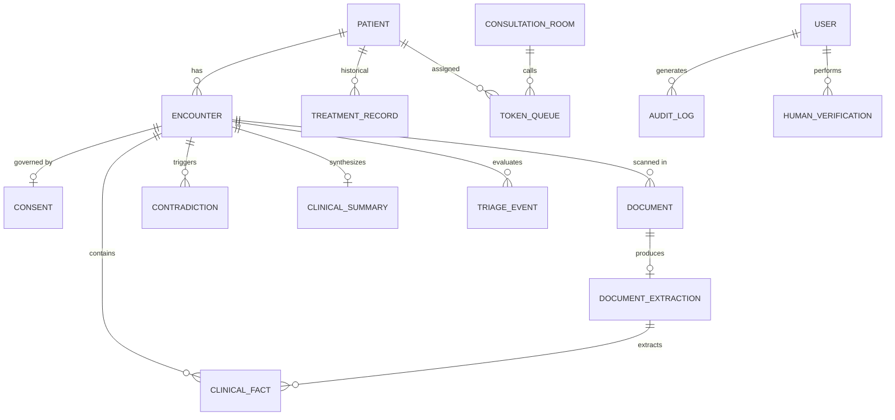
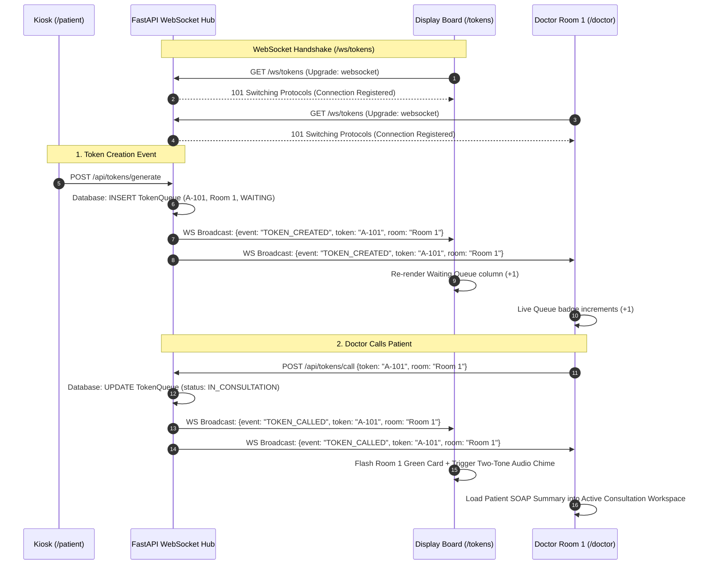
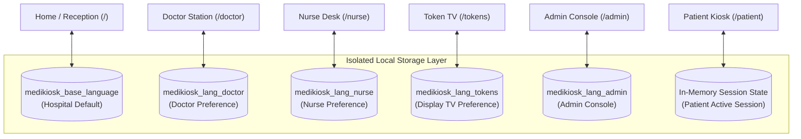

# 🏛️ Smart India Hackathon (SIH) — System Architecture

> **Project Title:** MediKiosk — AI-Assisted Multilingual Clinical Intake & Outpatient Orchestration  
> **Evaluation Focus:** End-to-End System Design, Data Schemas, WebSocket Event Flows & Security Architecture  

---

## 1. High-Level Multi-Tier Architectural Blueprint

MediKiosk is built on an enterprise, event-driven, decoupled client-server architecture designed for zero cloud vendor lock-in and high local availability:

```mermaid
flowchart TD
    subgraph CLIENT_TIER ["1. Presentation Layer (Next.js 14 App Router • React 18)"]
        UI_P["🏥 Patient Intake Kiosk\n(/patient)"]
        UI_D["👨‍⚕️ Doctor Station\n(/doctor)"]
        UI_N["👩‍⚕️ Nurse Desk\n(/nurse)"]
        UI_TV["📺 Token TV Display\n(/tokens)"]
        UI_A["⚙️ Hospital Admin\n(/admin)"]
    end

    subgraph NETWORK_TIER ["2. Communication & Transport Layer"]
        HTTP["REST API Gateway (HTTP/2 /api/*)\n• Proxied by Next.js rewrites\n• CORS & Rate Limiting"]
        WS["WebSocket Event Bus (/ws/tokens)\n• Low-latency bidirectional push\n• Real-time multi-room sync"]
    end

    subgraph SERVICE_TIER ["3. Clinical Engine & Application Layer (FastAPI Python)"]
        S_AUTH["Authentication & RBAC\n(JWT / BCrypt / Role Guards)"]
        S_SCHEMA["Clinical Concept Normalizer\n(clinical_schema.py)"]
        S_SYMPTOM["Adaptive Symptom Engine\n(Context-Aware Branching)"]
        S_OCR["Document & Rx Extractor\n(document_extractor.py)"]
        S_REDFLAG["Configurable Red-Flag Engine\n(JSON Rule AST Evaluator)"]
        S_CONTRA["Contradiction Detection Engine\n(Cross-Fact & Document Checks)"]
        S_SOAP["Deterministic SOAP Summarizer\n(Zero-Hallucination Notes)"]
        S_TOKEN["Token & Queue State Manager\n(Multi-Room Sequencer)"]
        S_FHIR["FHIR R4 Bundle Serializer\n(ABDM Standard Exporter)"]
    end

    subgraph DATA_TIER ["4. Data & Persistence Layer (SQLAlchemy ORM)"]
        DB[(Relational Clinical Database\nPostgreSQL / SQLite fallback)]
        M_PATIENT["Patients & Encounters"]
        M_FACTS["ClinicalFacts & Consents"]
        M_DOCS["Documents & Extractions"]
        M_QUEUE["TokenQueues & Rooms"]
        M_RULES["RedFlagRules & Versions"]
        M_AUDIT["Immutable AuditLogs"]
        
        DB --- M_PATIENT & M_FACTS & M_DOCS & M_QUEUE & M_RULES & M_AUDIT
    end

    CLIENT_TIER <==> NETWORK_TIER
    NETWORK_TIER <==> SERVICE_TIER
    SERVICE_TIER <==> DATA_TIER
```

---

## 2. Clinical Data Model & Entity-Relationship (ER) Diagram

MediKiosk enforces a normalized relational clinical schema ensuring full traceability from the raw spoken utterance or scanned image up to the verified physician prescription:

### Core Schema Entity Specifications (`backend/app/models.py`):

1. **`Patient`**: Master demographic record (UUID, UHID/ABHA, name, phone, age, gender, preferred_language, department).
2. **`Encounter`**: Time-bound clinical session (`status`: `in_progress`, `completed`, `cancelled`).
3. **`Consent`**: Legal DPDP Act consent log (`consent_info`, `consent_voice`, `consent_care`, recorded timestamps).
4. **`ClinicalFact`**: Atomic normalized fact key (`concept`: `chest_pain`, `value`: `true`, `certainty`: `confirmed`, `source`: `PATIENT_SPOKEN`, `confidence`: `0.96`, `verification_status`: `UNVERIFIED`).
5. **`Contradiction`**: Identified clinical conflict between patient input and medical documents (`conflict_type`, `severity`, `fact_a_id`, `fact_b_id`, `resolution_status`).
6. **`RedFlagRule` / `RedFlagRuleVersion`**: Versioned JSON-defined triage rule specifications.
7. **`TokenQueue`**: Sequenced queue item (`token_number`: `A-101`, `room_id`, `status`: `WAITING`, `IN_CONSULTATION`, `COMPLETED`).
8. **`ClinicalSummary`**: Deterministic structured SOAP draft (`chief_complaints`, `history_of_present_illness`, `past_history`, `medications`, `allergies`, `investigations`, `assessment_plan`).
9. **`AuditLog`**: Immutable compliance record (`user_id`, `action`, `resource_type`, `resource_id`, `details`, `timestamp`).

---

## 3. Real-Time WebSocket Event Architecture

The multi-room queue synchronization utilizes asynchronous non-blocking WebSockets over `/ws/tokens`:

---

## 4. Frontend Portal Isolation & State Design

MediKiosk implements strict portal boundaries to prevent cross-contamination across concurrent hospital workstations running in the same browser origin:

### Architectural Guarantees:
- **No Cross-Tab Invalidation:** Doctor changing their UI to English does **not** interrupt or switch a patient intake running on Kannada in another terminal.
- **Session Reset Boundary:** When a patient completes their intake or cancels, the kiosk session safely resets to the hospital's regional base language for the next citizen.

---

## 5. Security & Privacy Architecture

| Security Layer | Implementation Mechanism | Purpose |
| :--- | :--- | :--- |
| **Authentication** | BCrypt password hashing + stateless JWT role tokens | Protects physician, nurse, and admin workstations |
| **Role-Based Access (RBAC)** | FastAPI route guards with `Depends(get_current_user)` | Restricts clinical record edits to authenticated doctors |
| **Session Isolation** | Memory-scoped patient intake contexts | Guarantees patient B cannot view patient A's medical data |
| **Data Protection** | Sanitized patient identification; zero PII in WebSocket broadcasts | TV displays show token numbers, never medical diagnoses |
| **Medicolegal Audit Trail** | Append-only `AuditLog` entity recording all triage & fact edits | Provides non-repudiation for hospital legal compliance |
| **Interoperability Standards** | Native **FHIR R4 JSON** representation | Eliminates proprietary vendor data imprisonment |
