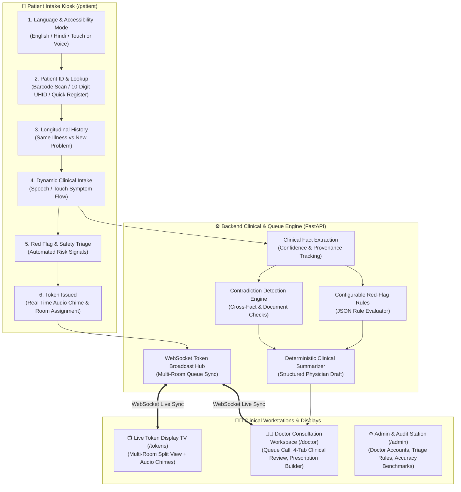

# 🏗️ MediKiosk System Architecture

MediKiosk is an AI-assisted, multilingual hospital intake and physician consultation platform designed for outpatient departments (OPDs). It bridges self-service patient check-in with real-time multi-room queue broadcasting and structured physician clinical workflows.

---

## 1. Core End-to-End Workflow



---

## 2. Clinical Information Model

Key entities defined in `backend/app/models.py`:

- **Demographics & History:** `Patient`, `TreatmentRecord`, `Encounter`, `Consent`.
- **Clinical Extractions:** `ClinicalFact`, `Medication`, `Allergy`, `LabResult`, `Document`, `DocumentExtraction`.
- **Decision Support & Safety:** `ClinicalSummary`, `RedFlagRule`, `RedFlagRuleVersion`, `RedFlagEvent`, `TriageEvent`, `Contradiction`, `ContradictionResolution`.
- **Queue & Operations:** `TokenQueue`, `ConsultationRoom`, `User`, `HumanVerification`, `AuditLog`.

Every clinically meaningful entity maintains UUID primary keys, timestamped auditing (`created_at`, `updated_at`), extraction provenance (`source`, `confidence`), and verification tracking.

### The `ClinicalFact` Record
The fundamental atomic unit of clinical information extracted across the platform:
```json
{
  "concept": "chest_pain",
  "value": true,
  "certainty": "confirmed",
  "source": "PATIENT_SPOKEN",
  "source_language": "hi",
  "confidence": 0.94,
  "verification_status": "UNVERIFIED",
  "verified_by": null
}
```

---

## 3. Multilingual → Language-Neutral Architecture

```
Patient Input (English / Hindi)
    ↓
ASR / Touch Normalization
    ↓
Clinical Entity Extraction
    ↓
Language-Neutral Concept Schema (e.g., chest_pain, fever, cough_character)
    ↓
Red-Flag Rules / Contradictions / Physician Summary
```

Implemented in `backend/app/services/clinical_schema.py`. All downstream clinical reasoning (triage rules, contradictions, and summary formatting) operates purely on normalized `concept` keys, completely independent of the patient's spoken/selected language.

---

## 4. Real-Time Multi-Room Token & WebSocket Architecture

MediKiosk features a real-time event-driven queue synchronization engine:

1. **Token Generation:** When a patient completes kiosk intake (`/patient`), `POST /api/tokens/generate` creates a sequenced token (e.g. `A-101`) and broadcasts `TOKEN_CREATED` over WebSockets (`/ws/tokens`).
2. **Multi-Room TV Display (`/tokens`):** Connected display boards receive the event and render waiting tokens under their respective room columns with visual cues.
3. **Doctor Workspace (`/doctor`):** Attending physicians see real-time patient queues. Calling a patient triggers `POST /api/tokens/{id}/call`, which broadcasts `TOKEN_CALLED` with audio chime signals and updates the TV display board immediately.
4. **Instant Recall:** Doctors can re-chime absent patients via `POST /api/tokens/{id}/recall` (`TOKEN_RECALLED`).

---

## 5. Doctor Consultation Station (4-Tab Architecture)

Located at `/doctor`, the doctor workstation delivers a streamlined, tabbed clinical interface:

| Tab | Purpose & Features |
| :--- | :--- |
| **📋 Summary** | Clean, structured view of patient-reported chief complaints, duration, associated symptoms, question step details, current daily medications, and known allergies. |
| **📜 Past Medical History** | Longitudinal past hospital visit records, previous diagnoses, and historical treatments. |
| **📄 Documents** | Uploaded medical documents (prescriptions, lab tests, discharge cards) with OCR text extractions. |
| **💊 Prescription & Medicines** | Interactive prescription builder with instant quick-fill chips for common medications (Dolo 650, Augmentin, Pan 40, Cetirizine, etc.), custom medicine forms, clinical notes, diagnosis entry, and one-click saving to the patient's record. |

---

## 6. Configurable Red-Flag Safety Engine

Implemented in `backend/app/services/red_flag_engine.py`. Safety rules are stored as structured JSON conditions rather than hardcoded logic:

```json
{
  "all": [{"concept": "chest_pain", "operator": "equals", "value": true}],
  "any": [
    {"concept": "dyspnea", "operator": "equals", "value": true},
    {"concept": "radiation_to_arm", "operator": "equals", "value": true},
    {"concept": "sweating", "operator": "equals", "value": true}
  ]
}
```

- Rules support operators: `equals`, `gte`, `lte`, `gt`, `lt`.
- Rules are versioned (`RedFlagRuleVersion`) on every edit in the Admin portal (`/admin`).
- Administrators can test rules interactively via `POST /api/red-flags/rules/{id}/test`.

---

## 7. Contradiction Detection Architecture

Implemented in `backend/app/services/contradiction_engine.py`. Scans cross-source data to identify discrepancies:
- **MEDICATION_CONFLICT:** Patient denies taking daily medication, but an uploaded prescription lists active drugs.
- **ALLERGY_CONFLICT:** Patient reports no allergies, but records document hypersensitivity.
- **TEMPORAL_CONFLICT:** Conflicting symptom onset durations across different questions or records.

The engine never auto-resolves contradictions; it surfaces them as actionable alerts for physician review.

---

## 8. AI Provider Abstraction & Fallback Resilience

`backend/ai/providers/base.py` provides clean provider interfaces (`SpeechToTextProvider`, `OCRProvider`, `ClinicalNLPProvider`, `SummaryProvider`). 
- Wrapped in `FallbackProvider` to guarantee graceful degradation.
- If an AI service fails, the platform automatically falls back to touch-based input, manual text entry, or deterministic rule templates without crashing the user interface.
