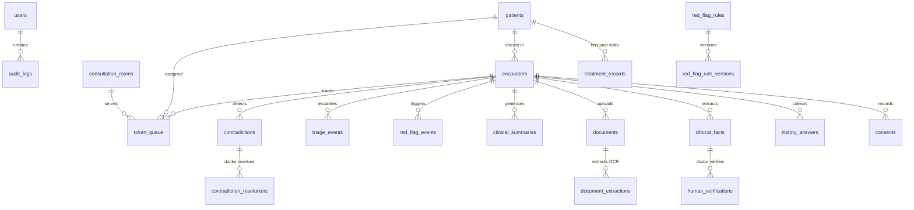

# 🗄️ MediKiosk Database Schema & Architecture Guide

This document provides a comprehensive technical reference for the **20 active database tables** in MediKiosk, detailing their purpose, columns, relationships, and lifecycle.

---

## 1. Database Architecture Overview

- **Local Development:** Single SQLite database file (`medikiosk.db`) in the project root.
- **Production / Docker:** PostgreSQL database instance configured via `DATABASE_URL`.
- **ORM & Migrations:** Python SQLAlchemy ORM with foreign key cascades and UUID-based primary keys (`GUID`).

---

## 2. Table-by-Table Reference

---

### Domain 1: Users, Authentication & Rooms

#### 1. `users`
- **Purpose:** Stores credentials, passwords, and assigned roles for doctors, triage staff, and administrators.
- **Key Columns:**
  - `id` (UUID): Primary key.
  - `username` (VARCHAR): Unique login identifier (e.g. `gopi`, `doctor`).
  - `hashed_password` (VARCHAR): Secure bcrypt/PBKDF2 password hash.
  - `role` (ENUM): `ADMIN`, `DOCTOR`, `TRIAGE`, `PATIENT`.
  - `full_name` (VARCHAR): Display name (e.g. `"Dr. Rahul Sharma"`).
  - `is_active` (BOOLEAN): Account status flag.

#### 2. `consultation_rooms`
- **Purpose:** Stores physical/virtual consultation room configurations for multi-room OPD broadcasting.
- **Key Columns:**
  - `id` (UUID): Primary key.
  - `name` (VARCHAR): Room label (e.g. `"Room A"`, `"Room B"`, `"Room 101"`).
  - `department` (VARCHAR): Medical specialty (e.g. `"General Medicine"`, `"Pediatrics"`).
  - `default_doctor` (VARCHAR, Nullable): Pre-assigned attending physician name.
  - `is_active` (BOOLEAN): Room availability status.

---

### Domain 2: Patient Demographics & Medical History

#### 3. `patients`
- **Purpose:** Stores master patient identity and demographics.
- **Key Columns:**
  - `id` (UUID): Primary internal identifier.
  - `patient_id` (VARCHAR): Hospital UHID / 10-digit barcode number (e.g. `"1000000001"`).
  - `name` (VARCHAR): Patient's full name.
  - `phone` (VARCHAR): Contact mobile number.
  - `age` (INTEGER): Patient age in years.
  - `gender` (VARCHAR): `"Male"`, `"Female"`, `"Other"`.
  - `preferred_language` (VARCHAR): `"en"` (English) or `"hi"` (Hindi).
  - `department` (VARCHAR): Assigned clinical department.
  - `is_synthetic` (BOOLEAN): Flag indicating demo/synthetic patient data.

#### 4. `treatment_records`
- **Purpose:** Stores longitudinal past medical visit records and illness history for returning patients.
- **Key Columns:**
  - `id` (UUID): Primary key.
  - `patient_id` (UUID $\rightarrow$ `patients.id`): Foreign key to the patient.
  - `illness_id` (VARCHAR): Historical illness reference code (e.g. `"ILL_FEVER_001"`).
  - `illness_name` (VARCHAR): Past condition name (e.g. `"Acute Bronchitis & Viral Fever"`).
  - `symptoms` (TEXT): Past symptoms recorded.
  - `diagnosis` (VARCHAR): Physician's diagnosis from past visit.
  - `treatment` (TEXT): Medications and treatments prescribed in the past.
  - `visit_date` (VARCHAR): Human-readable past date (e.g. `"12 Aug 2026"`).

---

### Domain 3: Intake Encounters, Consents & Questionnaire

#### 5. `encounters`
- **Purpose:** Represents one distinct outpatient check-in visit session at the kiosk.
- **Key Columns:**
  - `id` (UUID): Primary key.
  - `patient_id` (UUID $\rightarrow$ `patients.id`): Foreign key to the patient.
  - `mode` (VARCHAR): Intake mode (`"general"`, `"ayush"`).
  - `status` (VARCHAR): Visit progress (`"in_progress"`, `"completed"`).
  - `previous_illness_id` (VARCHAR, Nullable): Linked past illness ID if the patient is continuing the same illness.

#### 6. `consents`
- **Purpose:** Stores patient digital consent before clinical symptom intake begins.
- **Key Columns:**
  - `id` (UUID): Primary key.
  - `encounter_id` (UUID $\rightarrow$ `encounters.id`): Foreign key to current encounter.
  - `granted` (BOOLEAN): Whether consent was accepted.
  - `granted_at` (DATETIME): Timestamp when consent was recorded.

#### 7. `history_answers`
- **Purpose:** Stores raw responses from touch and voice interactions before clinical extraction.
- **Key Columns:**
  - `id` (UUID): Primary key.
  - `encounter_id` (UUID $\rightarrow$ `encounters.id`): Foreign key to encounter.
  - `question_concept` (VARCHAR): Concept key (e.g. `"symptom_onset"`, `"location"`).
  - `raw_answer` (JSON): Raw value selected or transcribed.
  - `certainty` (VARCHAR): `"confirmed"` or `"unknown"`.
  - `source_language` (VARCHAR): `"en"`, `"hi"`, etc.

---

### Domain 4: Clinical Facts, AI Summaries & Documents

#### 8. `clinical_facts`
- **Purpose:** The core clinical data unit. Stores normalized language-neutral clinical facts with confidence scores and verification states.
- **Key Columns:**
  - `id` (UUID): Primary key.
  - `encounter_id` (UUID $\rightarrow$ `encounters.id`): Foreign key to encounter.
  - `concept` (VARCHAR): Controlled key (e.g. `"chief_complaint"`, `"medication"`, `"allergy"`, `"symptom_onset"`).
  - `category` (VARCHAR): `"symptom"`, `"medication"`, `"allergy"`, `"pmh"`, `"investigation"`.
  - `value` (JSON): Structured value payload.
  - `label` (VARCHAR): Human-readable clinical rendering in doctor's language.
  - `source` (ENUM): Source provenance (`PATIENT_TOUCH`, `PATIENT_SPEECH`, `DOCUMENT_OCR`, `PHYSICIAN_ENTERED`).
  - `confidence` (FLOAT): 0.0 to 1.0 extraction confidence score.
  - `verification_status` (ENUM): `UNVERIFIED`, `PATIENT_CONFIRMED`, `PHYSICIAN_VERIFIED`, `PHYSICIAN_CORRECTED`, `REJECTED`.
  - `verified_by` (VARCHAR, Nullable): Physician name who verified the fact.
  - `verified_at` (DATETIME, Nullable): Verification timestamp.

#### 9. `documents`
- **Purpose:** Stores scanned prescriptions, lab reports, and uploaded medical documents.
- **Key Columns:**
  - `id` (UUID): Primary key.
  - `encounter_id` (UUID $\rightarrow$ `encounters.id`): Foreign key to encounter.
  - `doc_type` (VARCHAR): `"prescription"`, `"lab_report"`, `"discharge_summary"`.
  - `filename` (VARCHAR): Original uploaded file name.
  - `storage_path` (VARCHAR, Nullable): Local or blob storage path.
  - `status` (VARCHAR): `"uploaded"`, `"processing"`, `"processed"`, `"failed"`.
  - `ocr_text` (TEXT, Nullable): Raw text extracted via OCR engine.
  - `ocr_confidence` (FLOAT, Nullable): Overall OCR confidence score.

#### 10. `document_extractions`
- **Purpose:** Stores granular field-level key-value pairs extracted from OCR text.
- **Key Columns:**
  - `id` (UUID): Primary key.
  - `document_id` (UUID $\rightarrow$ `documents.id`): Foreign key to document.
  - `fact_id` (UUID $\rightarrow$ `clinical_facts.id`): Linked clinical fact.
  - `field_name` (VARCHAR): Extracted field name (e.g. `"medication_name"`, `"dosage"`).
  - `field_value` (JSON): Extracted value.
  - `confidence` (FLOAT): Field-level confidence.

#### 11. `clinical_summaries`
- **Purpose:** Stores structured clinical briefing drafts generated for the attending physician.
- **Key Columns:**
  - `id` (UUID): Primary key.
  - `encounter_id` (UUID $\rightarrow$ `encounters.id`): Foreign key to encounter.
  - `text` (TEXT): Formatted clinical summary text.
  - `version` (INTEGER): Summary iteration version (starts at 1).
  - `status` (VARCHAR): `"DRAFT"`, `"PHYSICIAN_VERIFIED"`, `"REJECTED"`.
  - `sources` (JSON): List of input sources used (e.g. `["PATIENT_TOUCH", "DOCUMENT_OCR"]`).
  - `facts_needing_verification` (INTEGER): Count of unverified facts.
  - `contradictions_count` (INTEGER): Count of active unresolved contradictions.

---

### Domain 5: Clinical Safety, Red Flags & Triage

#### 12. `red_flag_rules`
- **Purpose:** Stores hospital-configured emergency screening rules.
- **Key Columns:**
  - `id` (UUID): Primary key.
  - `rule_id` (VARCHAR): Unique rule code (e.g. `"RF_CHEST_001"`, `"RF_BLEED_005"`).
  - `name` (VARCHAR): Human-readable rule title.
  - `enabled` (BOOLEAN): Whether the rule is actively evaluated during intake.
  - `priority` (ENUM): `"HIGH"`, `"MEDIUM"`, `"LOW"`.
  - `version` (VARCHAR): Rule version string (e.g. `"1.0"`).
  - `action` (VARCHAR): Action triggered (e.g. `"URGENT_TRIAGE"`, `"FLAG_FOR_REVIEW"`).
  - `conditions` (JSON): JSON logic rules engine structure (`{"all": [...], "any": [...]}`).

#### 13. `red_flag_rule_versions`
- **Purpose:** Immutable audit snapshots of red-flag rule condition changes.
- **Key Columns:**
  - `id` (UUID): Primary key.
  - `rule_id` (VARCHAR): Linked rule ID.
  - `version` (VARCHAR): Version number.
  - `conditions_snapshot` (JSON): Exact condition logic at that version point.

#### 14. `red_flag_events`
- **Purpose:** Stores records when a patient's symptoms trigger an active red flag rule.
- **Key Columns:**
  - `id` (UUID): Primary key.
  - `encounter_id` (UUID $\rightarrow$ `encounters.id`): Encounter where alert was triggered.
  - `rule_id` (VARCHAR): Triggered rule reference.
  - `priority` (VARCHAR): Alert priority level.
  - `triggered_by_fact_id` (UUID $\rightarrow$ `clinical_facts.id`): Triggering clinical fact.
  - `patient_notified` (BOOLEAN): Whether the kiosk showed the immediate safety notice.
  - `dismissed` (BOOLEAN): Whether triage nurse/doctor dismissed the alert.

#### 15. `triage_events`
- **Purpose:** Tracks nurse triage priority assignments and escalations.
- **Key Columns:**
  - `id` (UUID): Primary key.
  - `encounter_id` (UUID $\rightarrow$ `encounters.id`): Foreign key to encounter.
  - `priority` (VARCHAR): Assigned triage category (`"EMERGENT"`, `"URGENT"`, `"ROUTINE"`).
  - `reason` (VARCHAR): Clinical rationale.
  - `escalated_to` (VARCHAR, Nullable): Assigned staff role or doctor.

---

### Domain 6: Contradictions & Conflict Resolution

#### 16. `contradictions`
- **Purpose:** Stores detected clinical discrepancies across multiple sources (e.g. speech vs scanned document).
- **Key Columns:**
  - `id` (UUID): Primary key.
  - `encounter_id` (UUID $\rightarrow$ `encounters.id`): Foreign key to encounter.
  - `fact_a_id` (UUID $\rightarrow$ `clinical_facts.id`): First conflicting fact.
  - `fact_b_id` (UUID $\rightarrow$ `clinical_facts.id`): Second conflicting fact.
  - `type` (VARCHAR): Discrepancy category (`"medication_conflict"`, `"timeline_mismatch"`).
  - `description_a` / `description_b` (TEXT): Explanations of the conflicting claims.
  - `status` (VARCHAR): `"UNRESOLVED"` or `"RESOLVED"`.

#### 17. `contradiction_resolutions`
- **Purpose:** Stores the physician's official clinical decision resolving a detected contradiction.
- **Key Columns:**
  - `id` (UUID): Primary key.
  - `contradiction_id` (UUID $\rightarrow$ `contradictions.id`): Foreign key to contradiction.
  - `decision` (VARCHAR): Resolution type (`"KEEP_A"`, `"KEEP_B"`, `"DISCARD_BOTH"`, `"MANUAL_EDIT"`).
  - `resolved_by` (VARCHAR): Doctor who made the decision.
  - `kept_fact_id` / `discarded_fact_id` (UUID): Fact IDs preserved or pruned.

---

### Domain 7: Queue & Token Management

#### 18. `token_queue`
- **Purpose:** Real-time patient consultation tokens broadcasting live to TV displays and Doctor dashboards.
- **Key Columns:**
  - `id` (UUID): Primary key.
  - `token_number` (VARCHAR): Formatted 3-digit queue number (e.g. `"001"`, `"002"`).
  - `patient_id` (UUID $\rightarrow$ `patients.id`): Linked patient.
  - `encounter_id` (UUID $\rightarrow$ `encounters.id`): Linked visit encounter.
  - `status` (ENUM): `WAITING`, `CALLED`, `IN_CONSULTATION`, `COMPLETED`, `CANCELLED`.
  - `doctor_id` (VARCHAR, Nullable): Attending physician identifier.
  - `doctor_name` (VARCHAR, Nullable): Attending physician display name.
  - `room_number` (VARCHAR, Nullable): Consultation room assigned (e.g. `"Room A"`).
  - `department` (VARCHAR): OPD department.
  - `triage_priority` (VARCHAR): `"EMERGENT"`, `"URGENT"`, `"ROUTINE"`.
  - `called_at` / `started_at` / `completed_at` (DATETIME): Queue lifecycle timestamps.

---

### Domain 8: Auditing & Human Verifications

#### 19. `human_verifications`
- **Purpose:** Detailed compliance audit log recording every physician verification, correction, or rejection of clinical facts.
- **Key Columns:**
  - `id` (UUID): Primary key.
  - `fact_id` (UUID $\rightarrow$ `clinical_facts.id`): Fact acted upon.
  - `action` (VARCHAR): `"verify"`, `"correct"`, `"reject"`.
  - `performed_by` (VARCHAR): Physician name / ID.
  - `previous_value` / `new_value` (JSON): Before-and-after audit diff.

#### 20. `audit_logs`
- **Purpose:** System-wide security, administrative, and compliance activity log.
- **Key Columns:**
  - `id` (UUID): Primary key.
  - `timestamp` (DATETIME): UTC event timestamp.
  - `actor` (VARCHAR): Username or system service executing the action.
  - `action` (VARCHAR): Event name (e.g. `"Doctor Created"`, `"Patient Deleted"`, `"OCR Processed"`).
  - `details` (TEXT, Nullable): Extra context and parameters.
  - `encounter_id` (UUID, Nullable): Associated encounter reference.
